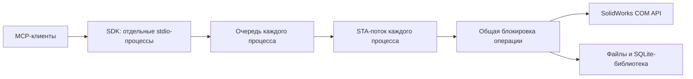

# SolidWorks Engineering MCP

Локальный MCP-сервер для SolidWorks 2024–2026 на Windows. Назначение: листовой металл,
сварные металлоконструкции, библиотека компонентов и подготовка чертежей с шаблонами ЕСКД.

Версия 0.1.1: работающая реализация COM с несколькими одновременными MCP-подключениями. Проверенный комплект и ограничения
описаны в [docs/VALIDATION.md](docs/VALIDATION.md). Поддержка версии в целевом диапазоне
не означает, что интеграционные испытания проведены на каждой из трёх версий.

## Запуск

Нужны Windows, установленный и лицензированный SolidWorks и Python 3.11+.
Сервер запускается в интерактивной сессии того же пользователя, что и SolidWorks.

```powershell
python -m venv .venv
.\.venv\Scripts\python.exe -m pip install -e .
Copy-Item solidworks-mcp.example.toml solidworks-mcp.local.toml
.\.venv\Scripts\python.exe tools/serve.py --doctor
.\.venv\Scripts\python.exe tools/serve.py
```

Перед запуском отредактируйте пути к шаблонам, формату листа, библиотеке и рабочей папке.
Пример настроен на обнаруженную установку SW 2025. Для 2024/2026 укажите фактические пути.
Разрешённые входные файлы определяются `read_roots`, `library_roots` и папками шаблонов;
результаты записываются только внутри `workspace`. Относительные пути в TOML считаются
от папки конфигурации, относительные пути аргументов инструментов — от `workspace`.

Транспорт — **stdio**. В stdout идут только сообщения MCP; диагностика — в stderr.
HTTP-сервер не публикуется. В настройках MCP-клиента укажите Python из `.venv` и абсолютный
путь к `tools/serve.py`. Универсальный пример находится в `examples/mcp-client.json`.

## Что умеет

| Область | Операции |
|---|---|
| Документы | Подключение/запуск SW, создание из шаблона, открытие, сохранение, закрытие, конфигурации, дерево элементов |
| Параметры | Свойства документа и конфигурации, размеры в мм/градусах, материалы `.sldmat`, масса и центр масс |
| Листовой металл | Эскизы и окружности, основание по открытому/замкнутому контуру, нормальные вырезы, толщина/радиус/K-фактор, развёртки DXF/DWG |
| Металлоконструкции | 3D-эскизы, группы профильных элементов `.sldlfp`, выбор конфигурации/типоразмера, угол и зазоры, списки резки и CSV |
| Библиотека | SQLite-индекс имён файлов, поиск, чтение конфигураций, вставка деталей и подсборок в сборку |
| Чертежи | Шаблоны `.drwdot`, форматы `.slddrt`, настройки `.sldstd`, виды модели и развёртки, масштаб, примечания, размеры модели, BOM, PDF/DXF/DWG |
| Комплект | Пробный U-кронштейн → SLDPRT + STEP + DXF + SLDDRW + PDF + JSON-манифест |

Схемы всех аргументов выдаются через `tools/list`, возможности — через ресурс
`solidworks://capabilities`. Есть prompt `sheet_metal_package`.

## Первый сквозной сценарий

Вызовите `sw_connect` с `{"request":{"launch":true}}`. Затем `sw_bracket_package`:

```json
{
  "request": {
    "name": "bracket",
    "designation": "MCP.001",
    "title": "Кронштейн",
    "web_mm": 100,
    "leg_mm": 40,
    "length_mm": 120,
    "thickness_mm": 2,
    "bend_radius_mm": 2,
    "k_factor": 0.42,
    "drawing": true
  }
}
```

Это открытый U-профиль, вытянутый по длине: `web_mm` и `leg_mm` задают размеры линий
исходного эскиза. Габариты после формирования радиусов и толщины нужно читать из модели;
они не объявляются наружными размерами готовой детали. K-фактор в примере служит для теста.

Каждый запуск создаёт новую папку `workspace/packages/<name>-<id>`. Существующие файлы
не заменяются. Манифест хранит параметры, результаты шагов, выходные файлы и открытые
документы. При ошибке остаются частичные результаты для диагностики.

## ЕСКД и выпуск документации

Сервер использует ваши шаблоны и связанные свойства `Обозначение`, `Наименование` и т. п.
Для пробного чертежа отдельно задаются размер A3 и файл ГОСТ-рамки: название `.drwdot`
само по себе не гарантирует правильный формат листа. Результат сценария помечен как пробный.

Подготовка производственного чертежа требует проверки схемы размеров, допусков,
технических требований, материала, основной надписи и правил предприятия. Перенос размеров
импортирует только помеченные размеры модели; он не изобретает конструкторские требования.
BOM SolidWorks не заменяет автоматически оформленную спецификацию ЕСКД.

## Исполнение и ошибки

- В каждом процессе COM-объекты принадлежат одному STA-потоку. Общая межпроцессная
  блокировка рабочей папки сериализует операции всех подключений.
- Документ выбирается явным именем или полным путём; перед изменением проверяется активация.
- Исходные файлы по умолчанию открываются для чтения. Перезапись требует `overwrite=true`.
  Для уже открытого документа режим не меняется; фактический режим возвращается в `read_only`.
- Закрытие изменённого документа требует сохранения или `discard_changes=true`.
- Несколько MCP-клиентов и процессы Chat/Cowork/Code в Claude могут использовать одну конфигурацию.
  Блокировка удерживается на время одной операции или всего `sw_bracket_package`, а не всего подключения.
  Ожидание происходит в рабочем потоке: `initialize`, списки MCP и `sw_job_status` остаются доступны.
  Не используйте разные рабочие папки для подключений к одному процессу SW: их блокировки независимы.
- Журнал: `workspace/.state/audit.jsonl`. Он содержит параметры и результаты, включая пути и свойства.
- При `TIMEOUT_PENDING` операция может продолжаться. Опросите `sw_job_status` по `job_id`.
  Повторять команду создания элемента до выяснения результата нельзя.
- Отмена запроса клиентом не прерывает COM-операцию. Входящие изменения не повторяются автоматически.
- История заданий ограничена текущим MCP-процессом; `job_id` нужно опрашивать через то же
  подключение. Состояние `waiting_for_lock` означает ожидание другой операции. После аварии
  или перезапуска сверяйте журнал и документы.
- Общей транзакции/автоматического отката CAD нет. Ошибка может оставлять часть изменений.
- Сервер не запускает произвольные макросы или код и не вызывает `ExitApp` при остановке.

## Проверки

```powershell
python tools/run_tests.py
python tools/smoke_test.py --config solidworks-mcp.local.toml
python tools/smoke_test.py --live --launch --package
```

Для дополнительной проверки каркаса и сборки сохраните протокол последнего успешного
сквозного теста в `workspace/smoke-latest.jsonl` и выполните `python tools/live_checks.py`.
Проверка нормального отверстия по удалённому объёму, размеров, DXF, закрытия и read-only:
`python tools/live_sheet_checks.py`.
Live-проверки создают реальные тестовые документы и файлы. См. точный состав в
[матрице проверок](docs/VALIDATION.md).

Если в Claude ранее появлялся `WORKSPACE_IN_USE` при запуске Cowork/Code, полностью завершите
Claude и запустите его снова после обновления до 0.1.1. Конфигурация запуска `tools/serve.py`
остаётся прежней. Убедиться в версии можно через `sw_status`: поле `server_version`.

## Границы текущей версии

Нет автоматического проектирования произвольной геометрии, раскроя/нестинга, расчёта
прочности, базы технологических таблиц гибки, PDM/Toolbox-интеграции, автоматических
сопряжений, универсального сопоставления ссылок `.sldlfp` и полной спецификации ЕСКД.
Библиотечные элементы `.sldlfp` индексируются, но вставка элементов с геометрическими
ссылками требует отдельного адаптера; профильные элементы поддерживаются напрямую.
Не реализованы кромочные фланцы, отбортовки и штамповочные инструменты
как самостоятельные MCP-команды. Это конкретные следующие расширения, не скрытые заглушки.

## Устройство проекта



Основные модули: `server.py` — MCP-контракт; `schemas.py` — аргументы;
`actor.py` — STA и задания; `backend.py` — COM; `com_dispatch.py` — особенности late binding;
`workflows.py` — сквозные сценарии; `config.py` — настройки и границы файлов;
`library.py` — индекс. Сервер зависит от официального [MCP Python SDK](https://github.com/modelcontextprotocol/python-sdk/tree/v1.30.0).
API сверялся с установленными библиотеками типов и справкой SW 2025. Внешняя справка:
[SolidWorks API](https://help.solidworks.com/2025/english/api/sldworksapiprogguide/Welcome.htm).
